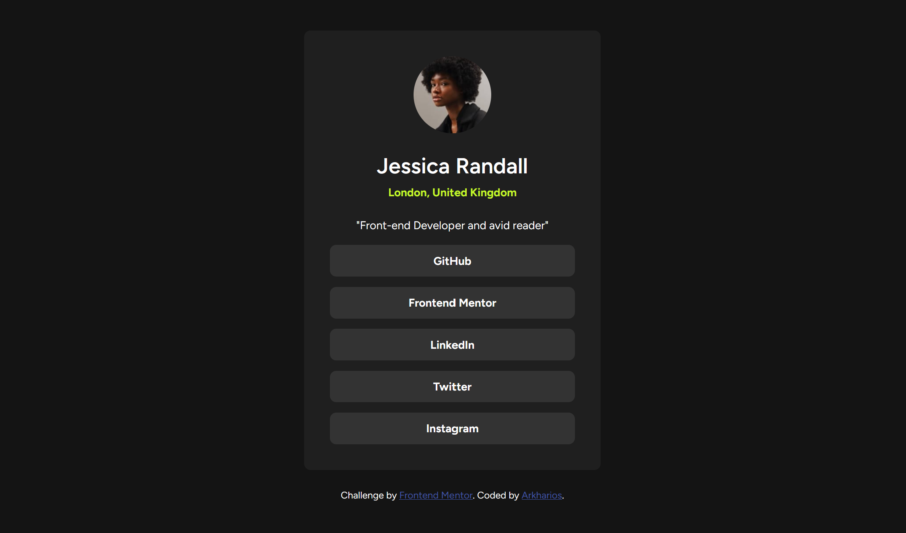
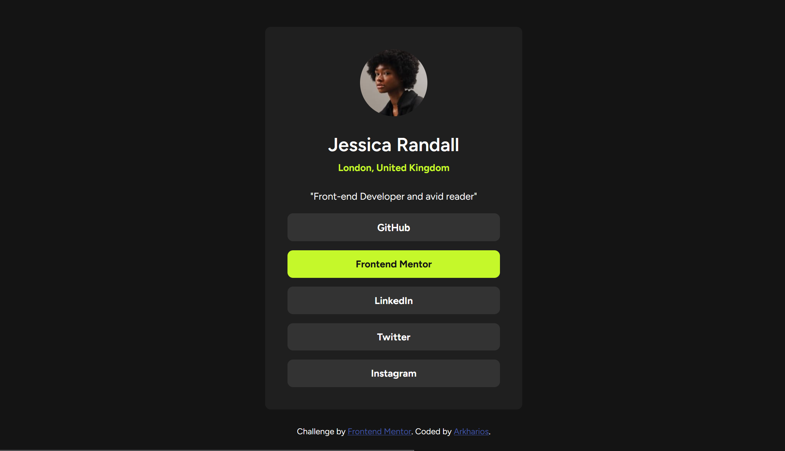

# Frontend Mentor - Social links profile solution

This is a solution to the [Social links profile challenge on Frontend Mentor](https://www.frontendmentor.io/challenges/social-links-profile-UG32l9m6dQ). Frontend Mentor challenges help you improve your coding skills by building realistic projects. 

## Table of contents

- [Overview](#overview)
  - [The challenge](#the-challenge)
  - [Screenshot](#screenshot)
  - [Links](#links)
- [My process](#my-process)
  - [Built with](#built-with)
  - [What I learned](#what-i-learned)
  - [AI Collaboration](#ai-collaboration)
- [Author](#author)


## Overview

### The challenge

This is a simple social link profile page design using simple html and CSS.

### Screenshot


**Default**


**Hover state**


**360px x 760**

### Links

- Solution URL: [Social link profile](https://your-solution-url.com)

## My process

### Built with

- Semantic HTML5 markup
- CSS custom properties
- Flexbox
- Mobile-first workflow


### What I learned

I learned how anchor``</a>`` elements could be used instead buttons or ``<div>`` elements.

To see how you can add code snippets, see below:

```html
<nav>
    <ul>
        <li><a href="#" target="_blank">Text Here</a></li>
    </ul>
</nav>
```
```css
ul {
    list-style: none;
    padding: 0;
    display: flex;
    flex-direction: column;
}

li {
    width: 100%;
    display: block;
}

ul li a {
    display: block;
    text-decoration: none;
    width: 100%;
    padding: 0.7rem;
}
```

### AI Collaboration

I used claude to decide the most optimal approach to making the link buttons div or ul/li.


## Author

- Frontend Mentor - [@Arkharios](https://www.frontendmentor.io/profile/Arkharios)

